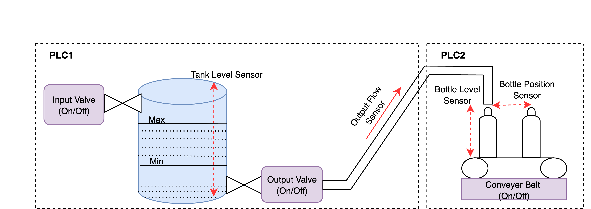
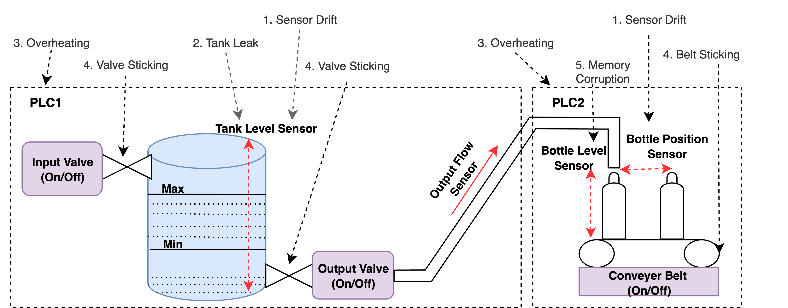
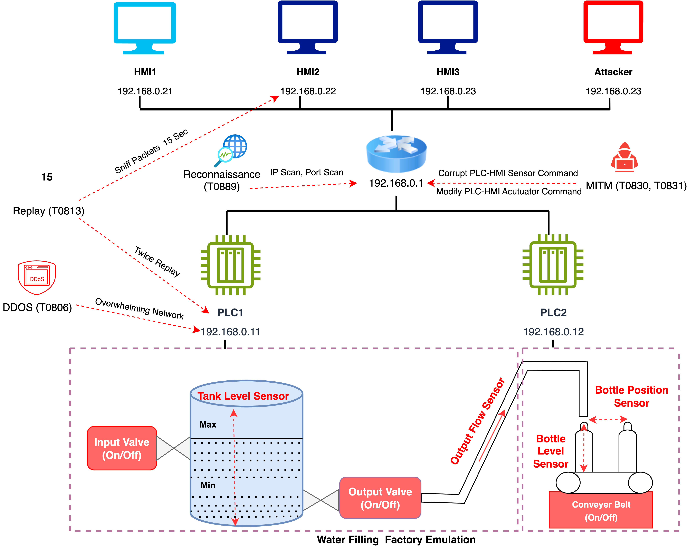
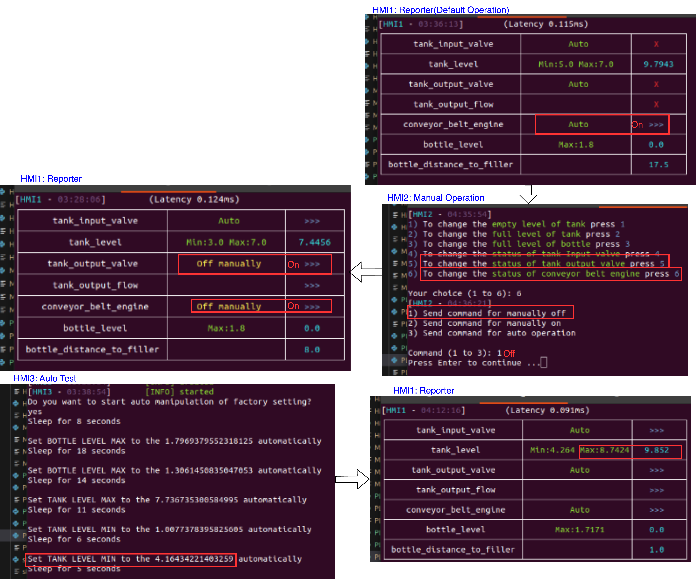

# CPS Testbed for Data Generation and Detection Workflows

This repository provides a Docker-based cyber-physical systems (CPS) testbed that emulates a water-filling process. It contains the components required to deploy the physical-process simulation, programmable logic controllers (PLCs), Human–Machine Interfaces (HMIs), system logging, network-traffic capture, and attacker nodes.

The testbed is used to collect PLC snapshots, syslog records, and network-traffic captures during normal operation, system-fault operation, and cyberattack experiments. The repository also includes scripts for running the single-stage and two-stage preprocessing, training, detection, ensemble, detection-time, and time-window workflows.

---

## Table of Contents

1. [Repository Organization](#repository-organization)
2. [System Emulation Architecture](#system-emulation-architecture)
3. [Prerequisites](#prerequisites)
4. [Installation](#installation)
5. [Data Generation Using the Testbed](#data-generation-using-the-testbed)
6. [Running the Single-Stage Workflow](#running-the-single-stage-workflow)
7. [Running the Two-Stage Workflow](#running-the-two-stage-workflow)
8. [Docker Commands](#docker-commands)
9. [References](#references)
10. [License](#license)

---

## Repository Organization

```text
CPS_testbed/
├── assets/          # Architecture and workflow figures
├── deployments/     # Docker deployment and testbed startup files
├── src/             # PLC, HMI, physical-process, logging, and attacker code
├── single_stage/    # Single-stage preprocessing, training, and evaluation
└── two_stage/       # Two-stage preprocessing, training, and evaluation
```

---

## System Emulation Architecture

### Overall System Setup



*Figure 1 – CPS testbed architecture showing the physical-process simulation.*

### System-Fault Generation Flow



*Figure 2 – System-fault generation during testbed operation.*

### Cyberattack Generation Flow



*Figure 3 – Cyberattack execution involving the PLCs, HMIs, attacker nodes, and physical-process simulation.*

### HMI Interaction



*Figure 4 – Interaction through HMI1, HMI2, and HMI3.*

---

## Prerequisites

| Tool | Version tested |
|---|---:|
| Ubuntu / Kali Linux | Ubuntu 20.04 LTS / Kali 2024 |
| Git | `>= 2.34` |
| Docker Engine | `>= 25.0` |
| Docker Compose | v2 |
| Wireshark | `>= 4.2` (optional) |
| Python | Python 3 |

---

## Installation

### 1. Install Git

```bash
sudo add-apt-repository ppa:git-core/ppa
sudo apt-get update
sudo apt-get -y install git
```

### 2. Clone the Repository

```bash
git clone https://github.com/parthoece/CPS_testbed.git
cd CPS_testbed
```

### 3. Install Docker

Ubuntu 20.04:

https://www.digitalocean.com/community/tutorials/how-to-install-and-use-docker-on-ubuntu-20-04

Kali Linux:

https://www.kali.org/docs/containers/installing-docker-on-kali/

Verify the installation:

```bash
docker version
docker compose version
```

### 4. Install Wireshark

Wireshark is optional and can be used to inspect packet captures.

```bash
sudo apt update
sudo apt install wireshark
sudo usermod -aG wireshark "$USER"
```

Log out and sign in again after changing the group membership.

### 5. Make the Shell Scripts Executable

Run from the directory containing the cloned repository:

```bash
find ./CPS_testbed -type f -name "*.sh" -exec chmod +x {} \;
```

---

## Data Generation Using the Testbed

The testbed supports data collection for:

1. Normal operation
2. System-fault operation
3. Cyberattack operation

PLC snapshots, syslog records, and network-traffic captures from different operations must be stored separately.

### 1. Prepare a New Experiment

Before starting an operation, move or archive the output files generated by the previous operation. This prevents data from different operating conditions from being combined.

### 2. Start the Testbed

Run:

```bash
cd CPS_testbed/deployments
sudo ./init_normal.sh
```

The script asks for the simulation mode:

```text
1) Normal Operation
2) System Faults
```

After the mode is selected, the script configures the logging location, stops previous containers, builds the Docker images, starts the containers, displays their status, and starts the corresponding network-traffic capture.

Check the running containers from another terminal:

```bash
cd CPS_testbed/deployments
sudo docker compose ps
```

### 3. Start the HMI Applications

Run each HMI in a separate terminal after the containers have started:

```bash
sudo docker exec -it hmi2 python3 /src/HMI1.py
```

```bash
sudo docker exec -it hmi2 python3 /src/HMI2.py
```

```bash
sudo docker exec -it hmi2 python3 /src/HMI3.py
```

The HMIs are used as follows:

- **HMI1:** displays the real-time physical-process state.
- **HMI2:** sends manual operator commands.
- **HMI3:** runs the automatic operating mode using the configured sensor ranges.

### 4. Generate Normal-Operation Data

1. Run `sudo ./init_normal.sh`.
2. Select `1) Normal Operation`.
3. Start HMI1, HMI2, and HMI3.
4. Operate the testbed for the required experiment duration.
5. Preserve the generated PLC snapshots, syslog records, and network-traffic capture as normal-operation data.

### 5. Generate System-Fault Data

1. Move or archive the output files from the previous operation.
2. Run `sudo ./init_normal.sh`.
3. Select `2) System Faults`.
4. Start HMI1, HMI2, and HMI3.
5. Operate the testbed for the required experiment duration.
6. Preserve the generated PLC snapshots, syslog records, and network-traffic capture as system-fault data.

### 6. Generate Cyberattack Data

A cyberattack experiment is started from normal operation.

1. Move or archive the output files from the previous operation.
2. Run `sudo ./init_normal.sh`.
3. Select `1) Normal Operation`.
4. Start HMI1, HMI2, and HMI3.
5. Start the attacker modules from separate terminals:

```bash
sudo docker exec -it attackermachine python3 /src/AttackerMachine.py
```

```bash
sudo docker exec -it attacker python3 /src/Attacker.py
```

For remote attack execution, configure the MQTT connection and run:

```bash
sudo docker exec -it attackerremote python3 /src/AttackerRemote.py
```

6. Operate the testbed for the required experiment duration.
7. Preserve the generated PLC snapshots, syslog records, and network-traffic capture as cyberattack data.

### 7. Stop the Testbed

After completing the operation, run:

```bash
cd CPS_testbed/deployments
sudo docker compose down
```

Archive the generated output files before starting the next operation.

---

## Running the Single-Stage Workflow

Run the following commands from the repository root:

```bash
cd CPS_testbed
```

### 1. Create a Python Environment

```bash
python3 -m venv .venv
source .venv/bin/activate
python -m pip install --upgrade pip
```

Install the Python packages used by the selected scripts:

```bash
pip install \
  numpy \
  pandas \
  scikit-learn \
  joblib \
  optuna \
  matplotlib \
  seaborn \
  psutil \
  xgboost \
  lightgbm \
  tensorflow \
  nltk \
  gensim \
  spacy
```

Install the NLTK and spaCy resources used by the log-processing scripts:

```bash
python -m nltk.downloader punkt stopwords wordnet omw-1.4
python -m spacy download en_core_web_sm
```

### 2. Configure the Input and Output Paths

Update the dataset, model, and output paths defined in the selected scripts.

The paths can be located with:

```bash
grep -RInE '(/home/|data_dir|model_dir|output_dir|base_dir)' single_stage
```

### 3. Run Single-Stage Preprocessing

Sensor data:

```bash
python single_stage/sensor_split.py
```

Log data:

```bash
python single_stage/log_split.py \
  --normal_file /path/to/normal_log.csv \
  --fault_file /path/to/fault_log.csv \
  --attack_file /path/to/attack_log.csv \
  --output_dir /path/to/single_stage/log_output
```

Traffic data:

```bash
python single_stage/traffic_split.py
```

### 4. Run Single-Stage Training and Detection

Run one complete group.

#### Decision Tree

```bash
python single_stage/sensor_train_decisiontree.py
python single_stage/log_train_decisiontree.py
python single_stage/traffic_train_decisiontree.py
python single_stage/ensemble_decisiontree.py
```

#### Random Forest

```bash
python single_stage/sensor_train_randomforest.py
python single_stage/log_train_random_forest.py
python single_stage/traffic_train_randomforest.py
python single_stage/ensemble_randomforest.py
```

#### XGBoost

```bash
python single_stage/sensor_train_xgboost.py
python single_stage/log_train_xgboost.py
python single_stage/traffic_train_xgboost.py
python single_stage/ensemble_xgboost.py
```

#### LightGBM

```bash
python single_stage/sensor_train_lgbm.py
python single_stage/log_train_lgbm.py
python single_stage/traffic_train_lgbm.py
python single_stage/ensemble_lgbm.py
```

### 5. Run the Single-Stage Evaluation Scripts

```bash
python single_stage/testtime_singlestage.py
python single_stage/timewindow_singlestage.py
```

---

## Running the Two-Stage Workflow

Run the following commands from the repository root:

```bash
cd CPS_testbed
source .venv/bin/activate
```

### 1. Configure the Input and Output Paths

Update the dataset, model, and output paths defined in the selected scripts.

The paths can be located with:

```bash
grep -RInE '(/home/|data_dir|model_dir|output_dir|base_dir)' two_stage
```

### 2. Run Two-Stage Preprocessing

Log data:

```bash
python two_stage/log/split_log2.py \
  --normal_file /path/to/normal_log.csv \
  --fault_file /path/to/fault_log.csv \
  --attack_file /path/to/attack_log.csv \
  --output_dir /path/to/two_stage/log_output \
  --w2v_model_path /path/to/word2vec.model
```

Traffic data:

```bash
python two_stage/traffic/split_traffic1.py
```

Configure the sensor-data paths in the selected sensor training script before execution.

### 3. Run Two-Stage Training and Detection

Run one complete group.

#### One-Class SVM

```bash
python two_stage/sensor/train_sensor_ocsvm2.py
python two_stage/log/train_log_ocsvm.py
python two_stage/traffic/train_traffic_ocsvm3.py
python two_stage/ocsvm_detection.py
```

#### Isolation Forest

```bash
python two_stage/sensor/isoforest_train_sensor.py
python two_stage/log/isoforest_train_log.py
python two_stage/traffic/isoforest_train_traffic.py
python two_stage/isoforest_detection.py
```

#### Local Outlier Factor

```bash
python two_stage/sensor/lof_train_sensor.py
python two_stage/log/lof_train_log.py
python two_stage/traffic/lof_train_traffic.py
python two_stage/lof_detection.py
```

#### Autoencoder

```bash
python two_stage/sensor/autoencoder_train_sensor.py
python two_stage/log/autoencoder_train_log.py
python two_stage/traffic/autoencoder_train_traffic.py
python two_stage/autoencoder_detection.py
```

### 4. Run the Two-Stage Ensemble and Evaluation Scripts

Update the paths defined in the scripts before execution.

```bash
python two_stage/ensemble/convert_ts.py
python two_stage/ensemble/check_shape.py
python two_stage/ensemble/align_data.py
python two_stage/ensemble/ensemble3v2.py
python two_stage/ensemble/testtime_2_stage.py
python two_stage/ensemble/timewindow_2stage.py
```

---

## Docker Commands

| Action | Command |
|---|---|
| List running containers | `docker ps` |
| List all containers | `docker ps -a` |
| List images | `docker images` |
| Open a container shell | `docker exec -it <container-name> bash` |
| Start Compose services | `docker compose up -d` |
| Build and start Compose services | `docker compose up --build` |
| Stop Compose services | `docker compose down` |
| Remove unused Docker resources | `docker system prune -a` |

---

## References

1. DigitalOcean. *How to Install and Use Docker on Ubuntu 20.04.*
2. Kali Linux. *Installing Docker on Kali Linux.*
3. Git-SCM. *Pro Git Book.*
4. Wireshark Foundation. *Wireshark User’s Guide.*
5. NIST. *Guide to Industrial Control Systems (ICS) Security*, SP 800-82 Rev. 2.
6. Dehlaghi-Ghadim, A. et al. (2023). *CPS_testbed — A framework for building industrial control systems security testbeds*. **Computers in Industry, 148**, 103906. https://doi.org/10.1016/j.compind.2023.103906

---

## License

Distributed under the MIT License. See [`LICENSE`](LICENSE) for the full text.
